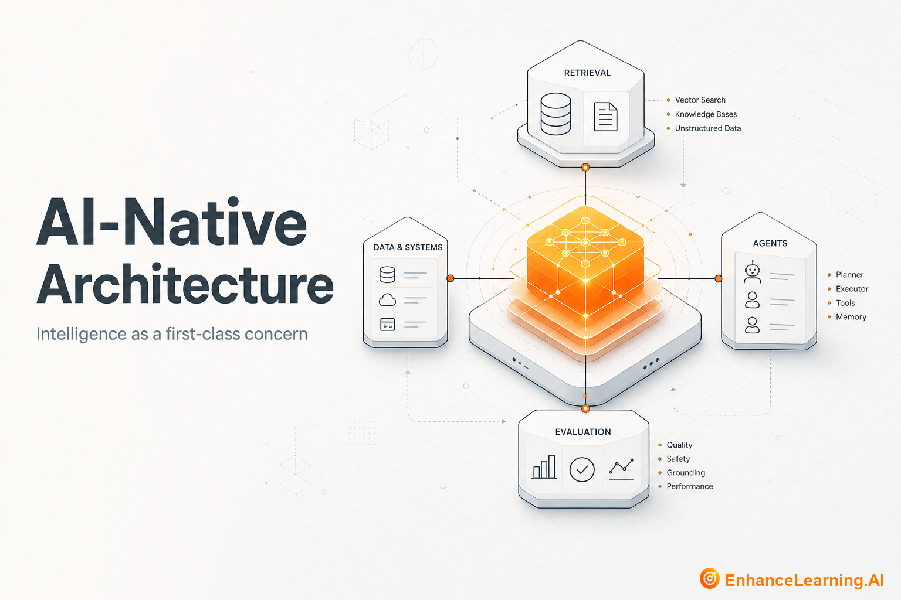

  

# AI-Native Architecture: Designing Systems Where Intelligence Is a First-Class Concern

> Maintained reading path from [EnhanceLearning.AI](https://enhancelearning.ai) — practitioner-grade articles for engineers, architects, and technology leaders building production AI-native systems.

**Topic on the site:** [AI-Native Architecture](https://enhancelearning.ai/articles?category=AI-Native+Architecture) · **Full library:** [enhancelearning.ai/articles](https://enhancelearning.ai/articles)

## What this repo is

A curated reading path for **AI-Native Architecture**. It is not a code SDK — it points to the foundation deep-dives on [EnhanceLearning.AI](https://enhancelearning.ai) so you can align on concepts, critique designs, and ship production systems that hold up.

AI-native architecture covers how you bound uncertainty, compose model calls with deterministic services, design failure modes for non-deterministic behaviour, and keep latency, cost, and governance visible at the system level. It is the difference between a demo that impresses and a platform that survives production.

## Who it's for

Software architects, staff engineers, and technology leaders shaping AI platforms and product foundations.

## Foundation articles

- [What Makes an Architecture AI-Native?](https://enhancelearning.ai/articles/what-makes-an-architecture-ai-native) — A practical definition of AI-native architecture: five properties that separate bolted-on model features from systems designed around probabilistic control.
- [Why AI-First and AI-Native Are Not the Same Thing](https://enhancelearning.ai/articles/why-ai-first-and-ai-native-are-not-the-same) — AI-first is business strategy; AI-native is architectural property. Conflating them produces slide-deck transformations and systems that still bolt models on.
- [Why Traditional Software Architecture Breaks Down for AI-Native](https://enhancelearning.ai/articles/why-traditional-software-architecture-breaks-down-for-ai-native) — Determinism, predictable latency, and binary failure assumptions from classical architecture collapse when LLMs sit on the critical path — and what to rebuild.
- [Why AI-Native Systems Are Composed, Not Coded](https://enhancelearning.ai/articles/why-ai-native-systems-are-composed-not-coded) — AI-native systems assemble models, tools, constraints, and evaluators — not hand-written control flow. How to design for composition in production.
- [Monolithic vs Modular AI-Native Architectures](https://enhancelearning.ai/articles/monolithic-vs-modular-ai-native-architectures) — Unified AI apps vs decomposed capability modules — trade-offs in velocity, eval isolation, team boundaries, and cost for production AI-native systems.
- [Why AI-Native Systems Need Different Failure Models](https://enhancelearning.ai/articles/why-ai-native-systems-need-different-failure-models) — AI-native failures are graded — partial outputs, silent errors, confident wrong answers. Binary failure models miss the damage until trust is gone.
- [The Architecture of Fallback in AI-Native Systems](https://enhancelearning.ai/articles/architecture-of-fallback-in-ai-native-systems) — When models fail or confidence drops, AI-native systems need layered fallbacks — rule engines, cached answers, human queues — not generic error messages.
- [The Hidden Coupling Between Prompts and AI System Architecture](https://enhancelearning.ai/articles/the-hidden-coupling-between-prompts-and-ai-system-architecture) — Prompt length, role structure, and tool definitions leak into service boundaries, data flows, and API contracts — coupling teams thought was decoupled.

## More from EnhanceLearning.AI

- Homepage: [https://enhancelearning.ai](https://enhancelearning.ai)
- All articles: [https://enhancelearning.ai/articles](https://enhancelearning.ai/articles)
- This topic filter: [AI-Native Architecture](https://enhancelearning.ai/articles?category=AI-Native+Architecture)
